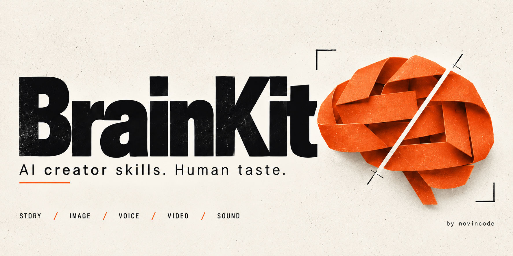

<p align="center">
  
</p>

# BrainKit — AI BrainKit

**Give your AI a production process. Keep your own taste.**

Open-source skills for **Claude Code, Codex, and other skill-compatible agents**. Turn a brief into a story, direct its images and voice, plan motion and sound, review the result, and carry your preferences into the next project.

Built by [novincode](https://github.com/novincode) with Codex. MIT licensed. No required subscription, bundled model, or API key for the instruction files. Connected generation services may have their own costs.

[Get started](#get-started) · [Skills](#choose-your-skill) · [Production coverage](docs/PRODUCTION.md) · [Examples](examples/calibration/short-scripts.md) · [Roadmap](docs/ROADMAP.md) · [Contribute](CONTRIBUTING.md)

## What BrainKit does

AI can generate a lot of material. Making the right material—and knowing what to cut—takes a process.

BrainKit gives an agent focused workflows for storytelling, visual communication, media generation, and review. A separate taste profile records what you actually like. A source bank keeps observations distinct from guesses. Small skill packages load references as needed.

- **Stories with somewhere to go:** concrete scenes, changing stakes, earned payoffs, speakable words.
- **A voice that fits:** clean narration, performance direction, pronunciation checks, controlled TTS auditions.
- **Images and video with a reason:** composition, reference fidelity, shot logic, continuity, output inspection.
- **Motion, music, and sound that serve the piece:** meaningful movement, cue sheets, space for dialogue, delivery checks.
- **Consistency without sameness:** reusable taste rules with scope, evidence, and room to change your mind.

Direct language and profanity are welcome when they fit. So are restraint, silence, and warmth. Originality comes from the material and decisions, not a mandatory tone or a list of forbidden words.

## Get started

Python 3.10+ is needed for local tooling. Reading the skill files needs no Python or API connection.

```sh
git clone https://github.com/novincode/brainkit.git
cd brainkit

# One skill for a Claude Code project
python3 tools/install.py --target /path/to/project/.claude/skills --skill brainkit-story

# The full kit for a Codex project
python3 tools/install.py --target /path/to/project/.agents/skills --all
```

Use your client's supported skill directory, then refresh discovery as required. The installer refuses existing destinations. Every package includes its own references and license. See [installation and compatibility](docs/INSTALLATION.md).

Install directly with the ecosystem installer:

```sh
npx skills add novincode/brainkit --skill brainkit-story --agent claude-code
npx skills add novincode/brainkit --skill brainkit-media --agent codex
```

For hosts without automatic skill discovery, supply the selected SKILL.md and its requested references as context.

## Try it on a real brief

**Write a short**

> Use brainkit-story. Write three 30-second fictional stories about a designer who keeps changing the font instead of publishing. Plain words. One dry, one warm, one blunt. Separate spoken words from direction.

**Produce the media**

> Use brainkit-media. Build the selected story into shot briefs, an image-generation brief, a music cue, and a sound plan. Use connected tools where available. Keep the character consistent and inspect actual outputs.

**Find your voice**

> Use brainkit-voice. Freeze this excerpt and design a small ElevenLabs audition. Compare voice and model separately. Keep clean speech separate from provider tags. Don't choose a winner until we've listened.

**Make it sound like you**

> Use brainkit-review. Here are the lines I liked and the lines I would never say. Suggest three small preference rules. Test them on a different topic before making them permanent.

Start with [six original calibration scripts](examples/calibration/short-scripts.md). Invented events are labeled; bring your real experiences for personal stories.

## Choose your skill

| Skill | Use it for | Output |
|---|---|---|
| `brainkit-director` | A project spanning several crafts | Brief, routing, consistent handoffs |
| `brainkit-story` | Scripts, hooks, scenes, explainers, essays | Spoken script and meaningful beats |
| `brainkit-research` | Studying creators and sources | Evidence-linked observations and transfer tests |
| `brainkit-voice` | Voiceover and expressive TTS | Clean/tagged text and audition record |
| `brainkit-visual` | Thumbnails, typography, color, motion | Visual system and storyboard |
| `brainkit-media` | Image/video generation, music, sound, edit and delivery | Asset briefs, connected production, inspection |
| `brainkit-review` | Revisions and personal taste | Specific edits and scoped preference proposals |
| `brainkit-measure` | Content experiments and outcomes | Comparison, uncertainty, next test |
| `brainkit-maintain` | Extending this repository | Small changes, evaluations, contracts |

Install only what you need. The director is optional. A one-line rewrite should not launch a production pipeline.

## Production tools

**Included:** instruction skills, craft references, local installation, source-study templates, production contracts, taste profiles, calibration examples, evaluations, and repository checks.

Connect your preferred tools for image/video generation, speech synthesis, music, editing, rendering, and publication. BrainKit directs those tools through your agent and provides production briefs for each stage.

## Make it yours

Copy [the neutral profile](profiles/default.json) to `local/profiles/me.json`. Pass its path or relevant fields explicitly. Record exact feedback with [the feedback template](templates/feedback.json).

Keep raw transcripts, voice trials, personal stories, credentials, and private profiles in ignored `local/`. They are excluded from installation. Preferences stay explicit and reversible; they do not train model weights.

## Built to extend

BrainKit follows the [Agent Skills format](https://agentskills.io/specification): concise SKILL.md entries with directly linked references. No required server, custom package manager, startup hooks, or hidden paid calls.

| Directory | Purpose |
|---|---|
| `skills/` | Standalone installable craft packages |
| `bank/` | Source-linked studies and reusable hypotheses |
| `profiles/` | Public neutral profile templates |
| `templates/` | Brief, script, study, voice, visual, feedback, experiment records |
| `evals/` | Positive, negative, edge, and adversarial task cases |
| `tools/` and `tests/` | Installation and structural checks |
| `docs/` | Architecture, research, production scope, roadmap, handoff |

Read the [architecture](docs/ARCHITECTURE.md), [research](docs/RESEARCH.md), [production map](docs/PRODUCTION.md), and [maintainer handoff](docs/HANDOFF.md). Add depth as a reference before adding another expert persona.

## Development and contributions

```sh
python3 tools/validate.py
python3 -m unittest discover -s tests -v
```

Run the checks before submitting a change. Bring a reproducible failure, a useful example, or a focused improvement. Include the prompt, relevant skills, result, and the change you wanted. See [contributing](CONTRIBUTING.md) and [evaluation](docs/EVALUATION.md).

Study mechanisms; respect sources. The public bank contains original annotations and links, not a collection of copied creator scripts. See [reuse policy](THIRD_PARTY.md).

## Support BrainKit

If BrainKit helps you make something worth sharing, a star helps others find it. Useful feedback and examples help make it better.

[Sponsor novincode on GitHub](https://github.com/sponsors/novincode) · [Buy me a coffee](https://buymeacoffee.com/novincode)

Open source under the [MIT license](LICENSE). No telemetry in the included tooling. External providers and third-party installers follow their own policies.
