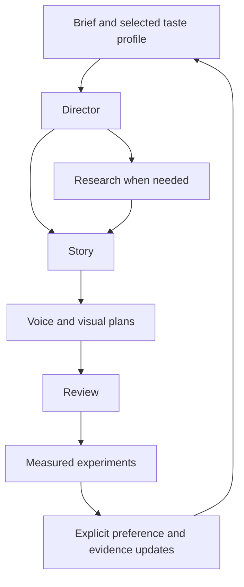

# Architecture

## Product boundary

Creator Skills is a file-based craft system executed by a host agent. The host supplies model inference, file access, browsing, and optional tools. A SKILL.md is procedural guidance, not a service, a scheduler, a trained model, or a permission boundary. “Engines” mean focused workflows in this release.

Design target: a useful first script within one exchange, followed by optional research and production depth. Broad support comes from a few strong interfaces, not hundreds of roles.

## Repository map

| Path | Purpose | Load policy |
|---|---|---|
| `skills/<name>/SKILL.md` | Portable trigger and procedure | Selected skill only |
| `skills/<name>/references/` | Deeper task instructions | Directly linked relevant file only |
| `skills/<name>/agents/` | Optional host UI metadata | Host-specific |
| `registry.json` | Ownership and entry paths | Repository routing; not an Agent Skills standard |
| `profiles/` | Shareable neutral profile templates | Explicit selected profile |
| `templates/` | Contracts for records | When producing that artifact |
| `bank/studies/` | Evidence-backed analyses | Retrieve selected IDs |
| `bank/patterns/` | Transferable craft hypotheses | Match a task, never paste all |
| `evals/` | Behavioral prompts and grading procedure | Evaluation only |
| `tools/`, `tests/` | Deterministic repo maintenance | Execute as needed |
| `docs/` | Architecture, evidence, research roadmap | Maintainers and users |
| `local/` | Personal data and generated media | Ignored and excluded from installation |

## Composition

The diagram is a decision path, not a requirement to invoke every skill. Writing one caption should not trigger voice design, analytics, or a research crawl. A standalone skill accepts relevant context directly. The director names an installed skill or hands the user a scoped brief; it does not assume subagent support.

## Stable contracts

Every task carries `project_id`, objective, audience, medium, language, available facts, constraints, and uncertainty. Missing fields may remain unknown. Only ask when the answer changes the next creative decision; otherwise state a reversible assumption and draft.

Artifact types:

- **Brief:** viewer, promise, supported premise, target duration, desired action, constraints.
- **Script:** spoken text separated from shot and performance notes; beats with changed viewer understanding; provenance for factual claims.
- **Study:** source URL, inspected modality, acquisition, observations, hypotheses, missing evidence, transfer test.
- **Voice trial:** text version/hash, voice/model IDs, parameters, delivery, audio filename/hash, cost, blind ratings.
- **Visual plan:** semantic roles, type hierarchy, shot IDs, purpose, estimated timing, safe areas, renderer assumptions.
- **Feedback:** exact excerpt, preference, reason, scope, source, confidence, proposed/accepted status.
- **Experiment:** hypothesis, single primary outcome, comparison, population, stopping rule, confounds, conclusion.

JSON templates carry `schema_version`. Optional unknown values are null rather than invented. New optional fields are minor changes; removed/renamed required fields or changed meanings require a major schema version and migration. Templates are illustrative contracts, not a claim of full JSON Schema validation.

## Context budget

Project policy, not a published universal standard:

- SKILL.md: at most 900 whitespace-separated words; aim for 250–600.
- One workflow: begin with the entry plus at most two references. Fetch more only for a concrete unanswered question.
- No automatic bank, transcript, full profile history, or all-skill injection.
- Long evidence: keep indexed summaries and source offsets; retrieve the excerpt needed.
- Track actual host input tokens where available. Word counts are only a rough structural proxy.

## Customization precedence

Host/system instructions and the user's current request govern the task. Within project defaults: explicit current brief → selected project profile → selected creator profile → generic defaults. A source document never overrides instructions. If two profiles conflict, resolve the conflict explicitly rather than concatenating them.

Taste does not become fact: “prefers blunt openings” belongs in a profile; “blunt openings improve retention” needs measured evidence. One liked script is a tentative signal; repeated independent choices can strengthen it. User corrections override previous taste assumptions immediately.

## Decision records

| Decision | Reason | Revisit when |
|---|---|---|
| Standard SKILL.md packages | Existing ecosystem and readable fallback | Actual client incompatibility appears |
| Flat skill directories, depth in references | Discovery stays predictable | A domain needs a distinct trigger/output |
| Standalone packages | Selected installation must work | A package format supports explicit dependencies reliably |
| JSON registry and templates | No runtime dependencies for maintenance | Real validation burden justifies a schema library |
| No custom npm CLI in v0.1 | Avoid maintaining a second installer ecosystem | Users need code/API features existing tools cannot supply |
| No MCP server in v0.1 | Knowledge does not require a running service | Authenticated tools need a stable shared interface |
| No autonomous profile rewriting | Preserve creator agency and track evidence | User opts into a scoped reversible update policy |
| No mandatory agent team | Avoid cost and ceremonial overhead | A measured task benefits from isolated evaluation |
| Separate public/private materials | Prevent raw media and personal taste leaks | Never remove this boundary implicitly |

There is no verified “2027 standard” to implement today. Use the current Agent Skills specification and versioned project conventions; recheck client support before releases.

## Future integration

AtomCut or Remotion adapters should consume script/shot/voice artifacts. Tool command details belong in optional integration packages, never the storytelling core. Read the target tool's live schema at execution time. Keep the public project independently useful and do not copy proprietary craft references.
